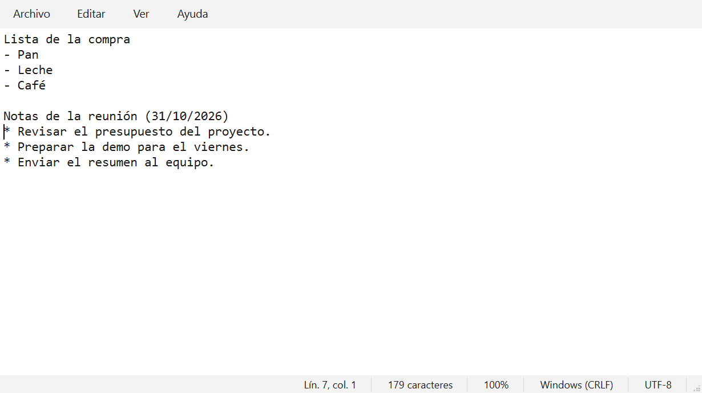
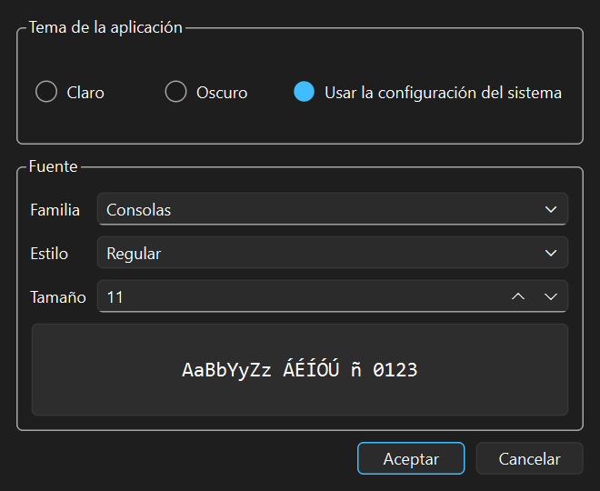
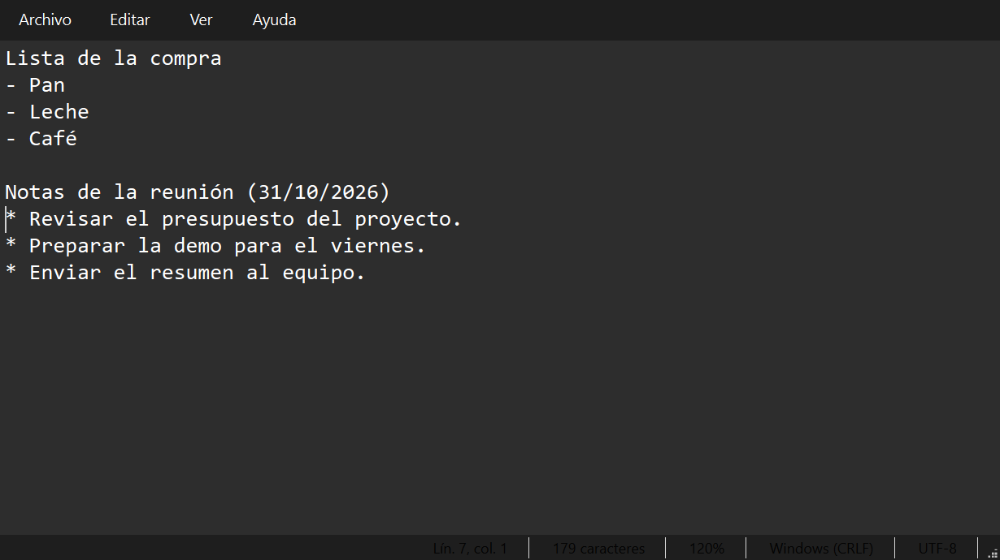

# Notepy

A simple notepad with a desktop GUI built with Python and PySide6, inspired by Windows Notepad.
Released under the MIT license.

## Features

- Create, open and save text files, with a *Recent files* menu.
- Detects and keeps the file encoding (UTF-8, UTF-8 with BOM, UTF-16 LE/BE, ANSI) and line endings (CRLF, LF, CR).
- Find and replace with match case, whole words and wrap around; F3 / Shift+F3 repeat the last search.
- Go to line, insert time and date, undo and redo.
- Zoom from 10% to 500% with Ctrl + mouse wheel, Ctrl++ and Ctrl+-.
- Light, dark or system theme, configurable font and word wrap.
- Status bar with line, column, character count, zoom, line ending and encoding.
- Page setup and printing.
- Several windows at once; files can be opened from the command line or dropped onto the window.

## Requirements

- Python 3.10 or newer.
- Dependencies in `requirements.txt`.

## Getting started

```bash
python -m venv .venv
.venv\Scripts\activate
pip install -r requirements.txt
cd app
python main.py
```

## Tests

```bash
cd app
python -m unittest discover -s tests
```

## Building the Windows executable

Prebuilt binaries are attached to every [release](https://github.com/caicesardev/Notepy/releases).
To build one yourself, from an activated virtual environment:

```bash
pip install -r requirements-dev.txt
powershell -ExecutionPolicy Bypass -File build.ps1
```

The script produces a single `dist/Notepy-<version>-windows-x64.exe`.

## Regenerating the UI

After editing the `.ui` files with Qt Designer (`pyside6-designer`):

```bash
cd app
pyside6-uic ui/MainWindow.ui -o ui/MainWindow_ui.py
pyside6-uic ui/FindReplaceDialog.ui -o ui/FindReplaceDialog_ui.py
pyside6-uic ui/SettingsDialog.ui -o ui/SettingsDialog_ui.py
pyside6-rcc images.qrc -o images_rc.py
```

## Project structure

```
app/
├── main.py                 Entry point
├── constants.py
├── src/
│   ├── models/             File format, encodings, line endings, search options and themes
│   ├── services/           Text decoding and encoding, search, zoom, recent files and theming
│   ├── settings/           Persistent user preferences
│   ├── widgets/            Text editor and status bar
│   └── windows/            Main window, find and replace, settings and window management
├── tests/
└── ui/                     Qt Designer files and generated code
```

See [CHANGELOG.md](CHANGELOG.md) for the release history.

---






